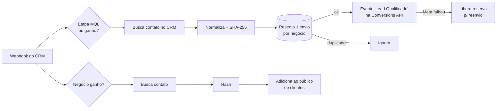

# CRM → Meta Ads: conversões offline (CAPI) + públicos automáticos

**Stack:** n8n · RD Station CRM (webhook + API) · Meta Conversions API · Meta Custom Audiences · Supabase (Postgres)
**Status:** em produção · 23 nós · roda a cada atualização de negócio no CRM

## Problema
O time de vendas qualifica leads e fecha negócios dentro do CRM, mas o Meta Ads só "via" o formulário preenchido. Resultado: o algoritmo otimizava para *volume* de lead, não para lead **bom**.

## Solução
Um webhook recebe cada atualização de negócio do CRM e segue dois caminhos em paralelo:

## Destaques técnicos
- **Idempotência real:** antes de enviar, grava uma "reserva" com chave única no Postgres. Se o CRM disparar o mesmo webhook duas vezes, o segundo envio é barrado pela constraint — nunca conta conversão em dobro.
- **Compensação em falha:** se a Meta recusar o evento, a reserva é desfeita para o reenvio automático (script diário cobre a janela de 47h da CAPI).
- **Privacidade:** e-mail e telefone saem do n8n só como hash SHA-256 (implementado em JS puro, porque o sandbox bloqueia `crypto`).
- **Atribuição:** distingue `fbclid` do site (gera `fbc` com a data de criação do negócio) de ID de lead de formulário nativo (`lead_id`).
- **Alertas sem spam:** negócio sem contato gera erro, mas deduplicado por negócio/dia.

## Resultado
Campanhas passam a otimizar para leads que o comercial realmente qualifica, e o público de clientes fica sempre atualizado sem exportar CSV.
