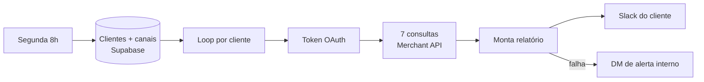

# Relatório semanal do Google Merchant Center por cliente

**Stack:** n8n · Google Merchant API (Reports) · OAuth2 · Supabase · Slack
**Status:** em produção · 18 nós · toda segunda às 8h, multi-cliente

## Problema
Cada e-commerce atendido tinha problemas escondidos no Merchant Center (preço fora do mercado, produto clicado sem estoque, cadastro reprovado) que só apareciam quando o resultado já tinha caído.

## Solução
Um fluxo lê a lista de clientes do banco, faz um loop por conta e consulta 7 relatórios da Merchant API. Um nó de código cruza tudo e posta um resumo legível no canal Slack de cada cliente.

## O que o relatório mostra
- Produtos **15%+ abaixo ou acima** do preço de referência do Google, ordenados por impressões
- Produtos entre os 20% mais vistos **sem nenhuma venda**
- **Mais vendidos da categoria que o cliente não tem** no catálogo (oportunidade de sortimento)
- Cliques em produtos **sem estoque**
- Produtos **reprovados/limitados** e o motivo traduzido para português
- Itens com muitas impressões e **zero clique**
- Pendências da conta (frete, telefone, avisos) e concentração de cliques

## Destaques técnicos
- **Falha alto, nunca em silêncio:** banco vazio ou cliente sem canal interrompe o fluxo e aciona o workflow de erro global.
- **Cada bloco isolado:** se uma consulta falha, só aquele bloco mostra "não foi possível consultar" e o resto do relatório sai.
- **Cabe no Slack:** algoritmo de corte progressivo (4 níveis) e quebra em 2 mensagens quando passa do limite.
- **Modo ensaio:** parâmetro que gera tudo sem enviar, para testar regra nova com segurança.
- Paginação, retry e regras por cliente configuradas no banco, não no código.
