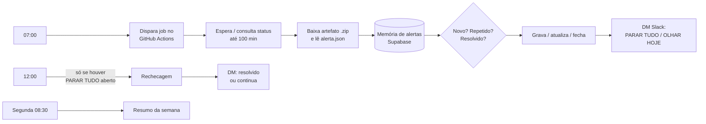

# Sistema de alertas de campanhas (rotina diária + checagem + resumo)

**Stack:** n8n · GitHub Actions · Supabase · Slack
**Status:** em produção · 3 workflows (07h, 12h e resumo de segunda) + workflow de erro global

## Problema
Monitorar campanhas de vários clientes todo dia gerava dois extremos: ou ninguém olhava, ou chegava alerta demais e ninguém lia.

## Solução
O processamento pesado roda em um job do **GitHub Actions**; o n8n orquestra, guarda memória dos alertas e decide **o que vale avisar**.

## Destaques técnicos
- **Só avisa exceção:** dois níveis (*PARAR TUDO* por cliente e *OLHAR HOJE* em resumo), com deduplicação e fechamento automático quando o problema some.
- **Estado persistente:** cada alerta tem ciclo de vida (aberto → atualizado → fechado) em tabela própria.
- **Confirmação de envio:** só marca como avisado o que o Slack confirmou; falha de envio é acusada.
- **Rechecagem ao meio-dia** só roda se houver algo crítico aberto: zero custo nos dias tranquilos.
- **Workflow de erro global** reaproveitado por todos os fluxos: qualquer falha vira DM.
