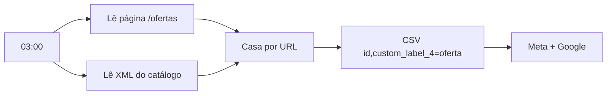

# Feed complementar de ofertas para Meta e Google

**Stack:** n8n · scraping de página de ofertas · XML de catálogo da plataforma de e-commerce · Meta Catalog · Google Merchant
**Status:** em produção · todo dia às 03h

## Problema
O e-commerce marcava produtos em oferta no site, mas a plataforma não exportava essa informação no feed. Não dava para fazer campanha só com produtos em promoção.

## Solução
Todo dia de madrugada o fluxo lê a página de ofertas da loja e o XML do catálogo, casa os produtos pela URL e gera um **feed complementar** (CSV `id, custom_label_4`) consumido pelo Meta e pelo Merchant Center.

## Destaques técnicos
- Produtos que **saíram da oferta** nos últimos 3 dias são enviados com rótulo vazio, para limpar o catálogo e não anunciar promoção que acabou.
- Permite conjuntos de anúncios e grupos de Shopping filtrados só por produtos em oferta.
