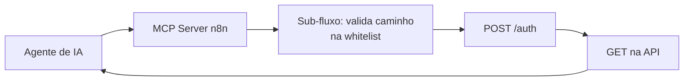

# Servidores MCP para e-commerce + captação de leads

## MCP somente leitura de plataforma de e-commerce
**Stack:** n8n (MCP Server Trigger) · API REST da plataforma · sub-workflows

Expõe a loja para agentes de IA (Claude etc.) como **9 ferramentas** de consulta: pedidos, produtos, estoque e afins.

- **Segurança em camadas:** só métodos GET, *whitelist* de caminhos permitidos e pedidos retornados **sem dado pessoal**.
- Token obtido por chamada em um sub-workflow dedicado, nunca exposto ao agente.
- Mesmo padrão replicado para outra plataforma (20 ferramentas).

## Lead Ads do Facebook → RD Station Marketing
**Stack:** n8n · Facebook Lead Ads · RD Station Marketing

Cada lead de formulário nativo (com perguntas condicionais de qualificação: loja física, vende online, orçamento) vira conversão no RD Station com:
- campos personalizados de qualificação,
- **UTMs reconstruídas** a partir do anúncio/conjunto (o formulário nativo não tem UTM),
- ID do lead guardado para depois voltar ao Meta como conversão (ver [CRM → Meta CAPI](01-crm-para-meta-capi.md)).

## Formulários do site → CRM
Formulário do site institucional e botão de WhatsApp capturados via webhook e enviados ao funil, com origem rastreada.
