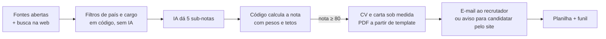

# Copiloto de candidaturas: busca de vagas com IA, no plano grátis

**Stack:** n8n self-hosted (VPS) · Groq e Gemini (planos gratuitos) · Google Sheets · Google Docs → PDF · Gmail

Construí para mim mesmo, do zero, um sistema que procura vagas, dá nota, adapta o CV e registra cada envio. É o mesmo problema de uma operação de mídia: muito volume, pouco tempo, risco de gasto fora de controle e necessidade de medir o que funciona.

## O que ele faz

1. **Coleta e triagem.** Várias fontes de vagas abertas (Remotive, Himalayas, Jobicy, RemoteOK, Working Nomads, Arbeitnow) e uma busca na web. Antes de gastar qualquer chamada de IA, regras em código descartam país fora do alvo e cargo que não serve.
2. **Nota por critérios.** A IA devolve 5 sub-notas (cargo, senioridade, localização e visto, idioma, requisitos). **Quem calcula a nota final é o código**, com pesos (25/15/20/15/25) e tetos: se o idioma exigido eu não falo, a vaga nunca passa de 40.
3. **Personalização.** Só vaga com nota 80 ou mais gera CV e carta na língua do anúncio (PT, ES ou EN), a partir de um template em Google Docs exportado em PDF.
4. **Saída.** Se a vaga tem e-mail, o envio sai sozinho; se não tem, vira "CV pronto, candidatar pelo site". No fim do dia chega um resumo por e-mail com links, textos e PDFs.
5. **Agências.** Três fluxos à parte: descobrir agências, varrer os sites atrás de vagas e contatos, e enviar o CV (máximo de 5 por dia, 1 por domínio, 30 dias sem repetir).
6. **Funil.** Uma planilha de log e outra de resumo medem candidatura ativa contra contato passivo, por país, modelo de trabalho e rota. Um fluxo diário às 19h acrescenta os envios novos sem sobrescrever o que já foi anotado à mão.

## Decisões que valem em qualquer operação de mídia

- **Nota única da IA infla.** No começo, 21 de 52 vagas tiraram 80 ou mais, muitas ruins. Passei a pedir sub-notas e calcular a nota no código. Mesmo princípio de não deixar o modelo decidir sozinho o que impacta verba.
- **Trava de custo em código.** Cada fluxo conta suas chamadas de IA por dia e para no teto, bem abaixo do limite grátis. Nada de cobrança surpresa.
- **Plano B quando a IA falha.** Se a Groq bate o limite diário, a triagem cai para o Gemini Flash-Lite, com teto próprio de chamadas. A vaga que a IA não avaliou volta para a fila do dia seguinte, em vez de ser marcada como vista.
- **Deduplicar sempre.** As fontes repetem vagas; o dedupe usa empresa e título normalizados. Linhas já existentes nunca são sobrescritas.
- **Rascunho versus publicado.** Mudar um fluxo ativo pelo MCP altera só o rascunho; a agenda só usa a mudança depois de publicar. Aprendi isso na prática e passei a conferir a versão ativa depois de cada ajuste.
- **Medir o funil.** Sem registro por canal, não dá para saber onde vale gastar esforço. O mesmo vale para mídia paga.

## O que isso mostra

Automação de ponta a ponta com n8n próprio hospedado por mim, integração de APIs, uso de IA com regras e limites, tratamento de erro e um painel para decidir. As mesmas peças que uso para alertas de verba, relatórios e conversões offline nos outros casos desta pasta.
